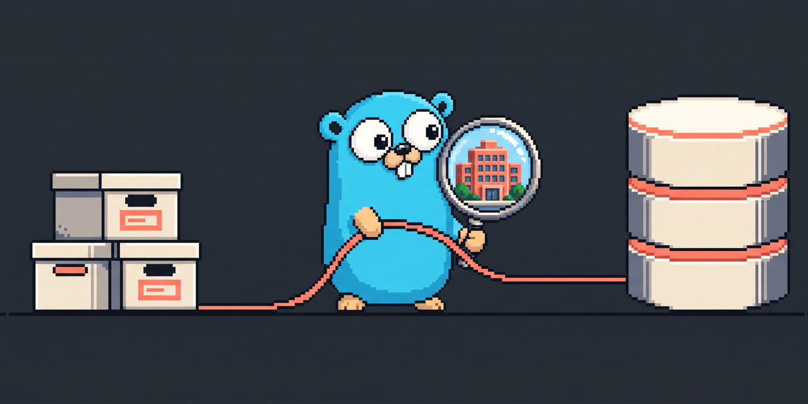

<h1 align="center">
  
</h1>

<p align="center">
  Banco de dados PostgreSQL com as informações do CNPJ da Receita Federal,<br>
  carregado do zero e atualizado todo mês de forma incremental.
</p>

<p align="center">
  
  
  
  <a href="https://codeberg.org/cuducos/minha-receita"></a>
</p>

---

Fork do [Minha Receita](https://codeberg.org/cuducos/minha-receita) **sem a API**:
as tabelas são o produto final e são consultadas direto no banco. O módulo e o
binário continuam se chamando `minha-receita`.

O que muda em relação ao projeto original:

- **Só PostgreSQL.** Não há outro backend nem a tabela de documentos JSON; os
  dados ficam no modelo relacional, que é o que se consulta.
- **Sem servidor HTTP.** Os comandos de API e o filtro de dados pessoais, que
  só valiam para os documentos JSON, foram removidos.
- **Atualização incremental.** O `update` carrega o mês novo em tabelas
  `*_staging` e aplica só a diferença, em vez de refazer a carga inteira.

## Como usar

```console
$ minha-receita create     # cria as tabelas
$ minha-receita download   # baixa os arquivos do mês na pasta de dados
$ minha-receita transform  # carga completa
$ minha-receita update     # meses seguintes, só a diferença
```

A [documentação do projeto original](https://docs.minhareceita.org) continua
valendo para instalação, para a origem dos dados e para o dicionário de campos;
as partes sobre a API não se aplicam aqui.

[Guia de contribuição](https://docs.minhareceita.org/contributing/)<br>
[Ajude a manter o projeto original](https://apoia.se/minhareceita)

## Artes

O avatar e o banner estão em [`art/`](art), em pixel art 16-bit: as caixas de
arquivo são os arquivos que a Receita publica, o gopher com a lupa é a carga
que lê e confere cada registro, e o cilindro é o banco onde tudo termina.
